# Image QA over Wikidata – proof of concept

Each sample is an **image of an entity** plus a **question answered by walking the Wikidata graph**.
An image is first matched to an entity through a CLIP embedding index (Qdrant), then the question is answered
with a SPARQL query over Wikidata.

> This file is generated by `node cli.js docs`. Edit the example metadata / READMEs instead.

## Quick start

```bash
mise run install
mise run all                       # starts Qdrant, build + index + e2e for every example, then regenerates docs
mise run examples                  # available examples
```

Tasks (`mise tasks`): `vector:up`, `build [example] [--refresh]`, `index [example]`, `e2e [example]`,
`query <example> <image> [--k N]`, `docs`, `all [example]`; they wrap `node cli.js`.
Configuration is read from environment variables, set in the `[env]` section of [mise.toml](mise.toml).
Image authors and licences: [ATTRIBUTION.md](ATTRIBUTION.md).

## Examples

### Egg Chair Designer Birth Year Example

Determine the chair entity from a photo of a chair, then follow `designed by (P287) → date of birth (P569)` in Wikidata to answer in which year the chair's designer was born.

- **Question:** In which year was the designer of this chair born?
- **Gold entity:** [Q1301042](https://www.wikidata.org/wiki/Q1301042)

<details><summary>Gold query</summary>

```sparql
SELECT ?designer ?designerLabel ?birth ?birthYear WHERE {
  BIND(wd:Q1301042 AS ?chair)
  ?chair wdt:P287 ?designer .
  ?designer wdt:P569 ?birth .
  BIND(YEAR(?birth) AS ?birthYear)
  SERVICE wikibase:label { bd:serviceParam wikibase:language "en". }
}
```

</details>

#### End-to-end result

**Query image** (`query/egg_chair_1958.jpg`):

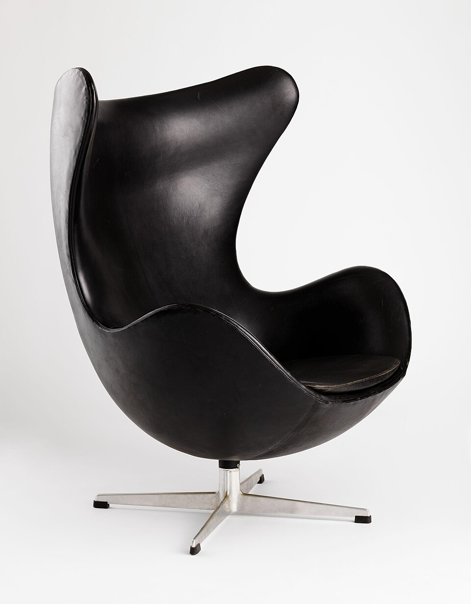

Top-5 of 26 indexed entities (embedder: `Xenova/clip-vit-base-patch32`). Expected entity **Q1301042** is **not** in the top 5.

| # | Image | Entity | Score |
|---|---|---|---|
| 1 | 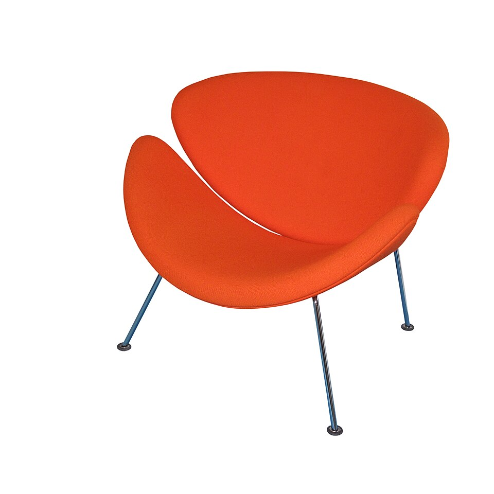 | **Orange Slice chair** ([Q133821854](https://www.wikidata.org/wiki/Q133821854)) | 0.8614 |
| 2 | 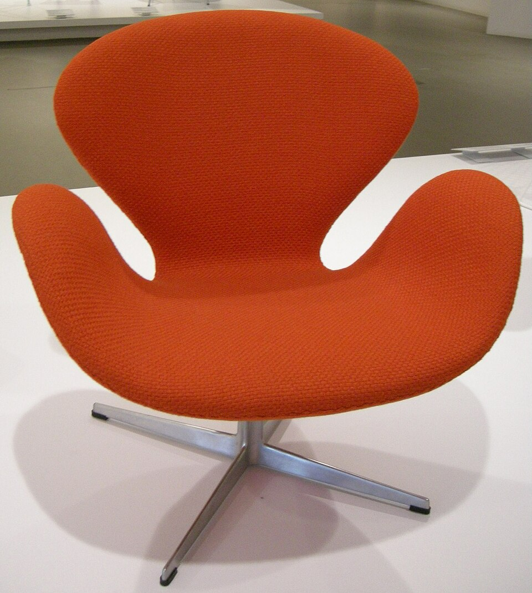 | **Swan** ([Q1290874](https://www.wikidata.org/wiki/Q1290874)) | 0.8367 |
| 3 | 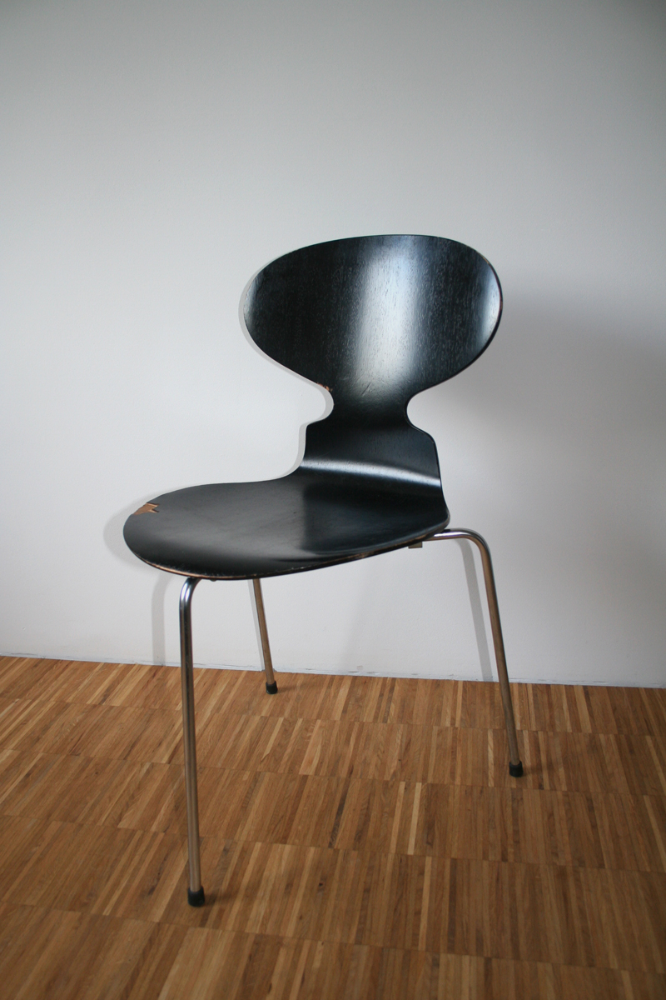 | **Ant** ([Q2038614](https://www.wikidata.org/wiki/Q2038614)) | 0.8288 |
| 4 | 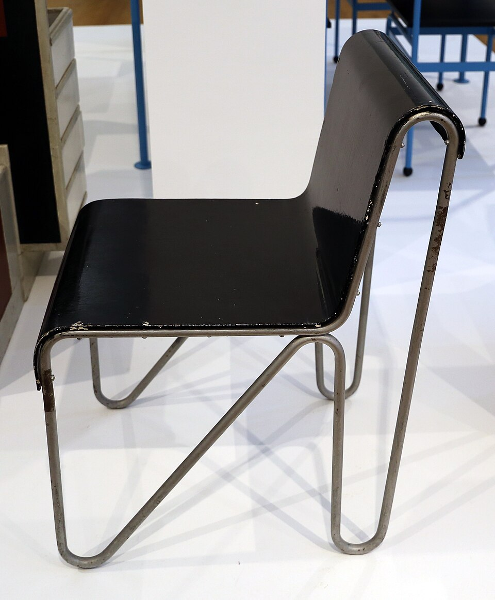 | **Tube-Framed Chair** ([Q134692936](https://www.wikidata.org/wiki/Q134692936)) | 0.8204 |
| 5 | 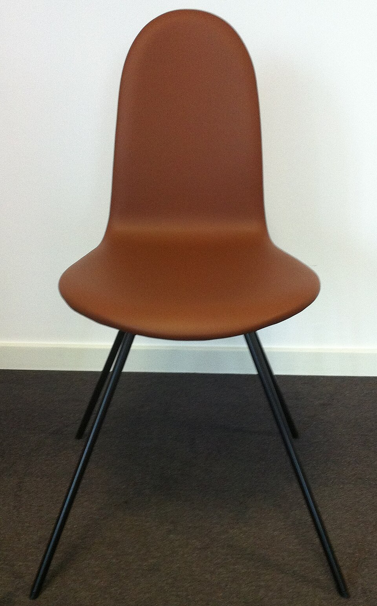 | **Model 3102** ([Q2440033](https://www.wikidata.org/wiki/Q2440033)) | 0.8196 |

➡️ Full write-up: [examples/egg-chair/README.md](examples/egg-chair/README.md)

### Game Boy Founder Birth Year Example

Determine the device entity from a photo of an electronic device model, then follow `manufacturer (P176) → founded by (P112) → date of birth (P569)` in Wikidata to answer in which year the founder of the console's manufacturer was born.

- **Question:** In which year was the founder of this console's manufacturer born?
- **Gold entity:** [Q186437](https://www.wikidata.org/wiki/Q186437)

<details><summary>Gold query</summary>

```sparql
SELECT ?manufacturer ?manufacturerLabel ?founder ?founderLabel ?birth ?birthYear WHERE {
  BIND(wd:Q186437 AS ?product)
  ?product wdt:P176 ?manufacturer .
  ?manufacturer wdt:P112 ?founder .
  ?founder wdt:P569 ?birth .
  BIND(YEAR(?birth) AS ?birthYear)
  SERVICE wikibase:label { bd:serviceParam wikibase:language "en". }
}
```

</details>

#### End-to-end result

**Query image** (`query/game_boy_original.jpg`):

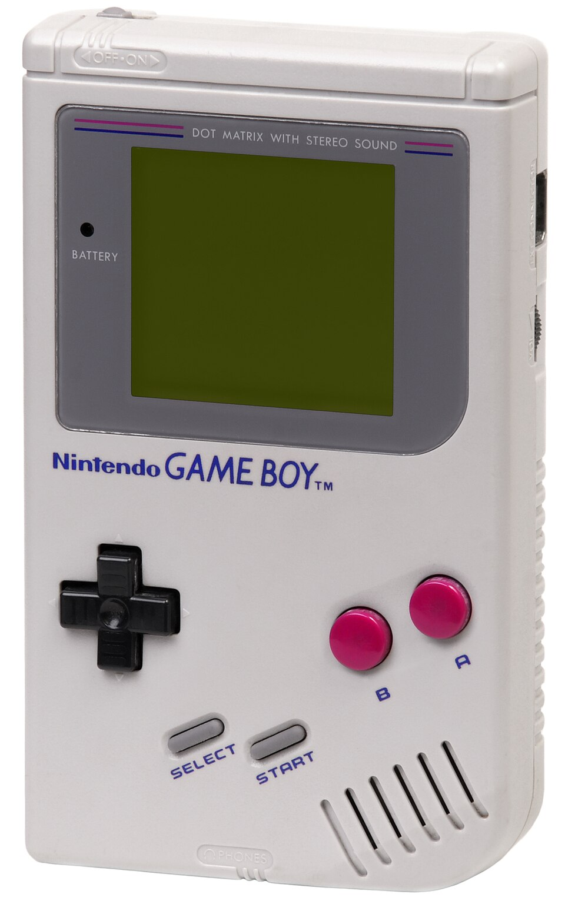

Top-5 of 26 indexed entities (embedder: `Xenova/clip-vit-base-patch32`). Expected entity **Q186437** is at rank **1**.

| # | Image | Entity | Score |
|---|---|---|---|
| 1 |  | ✅ **Game Boy** ([Q186437](https://www.wikidata.org/wiki/Q186437)) | 0.9347 |
| 2 | 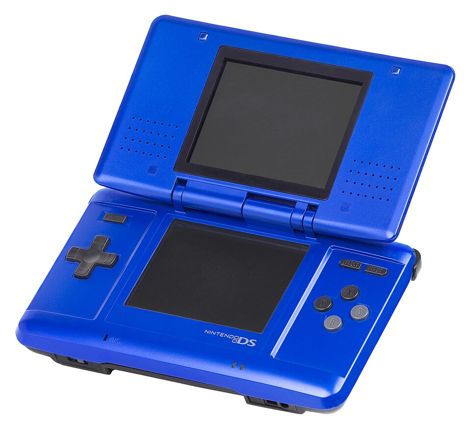 | **Nintendo DS** ([Q170323](https://www.wikidata.org/wiki/Q170323)) | 0.8550 |
| 3 | 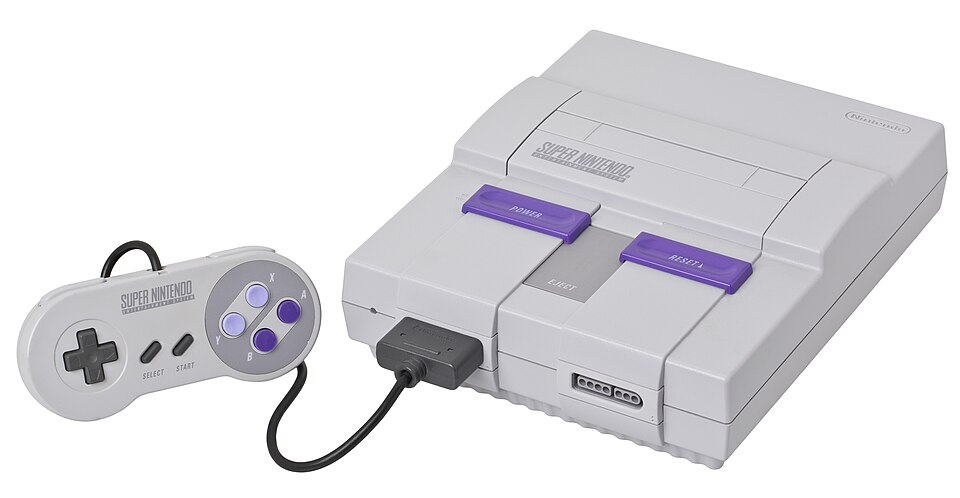 | **Super Nintendo Entertainment System** ([Q183259](https://www.wikidata.org/wiki/Q183259)) | 0.8309 |
| 4 | 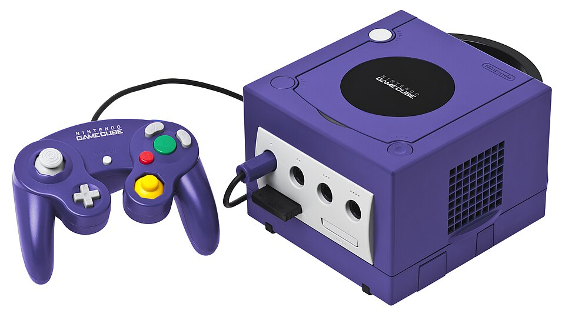 | **Nintendo GameCube** ([Q182172](https://www.wikidata.org/wiki/Q182172)) | 0.8286 |
| 5 | 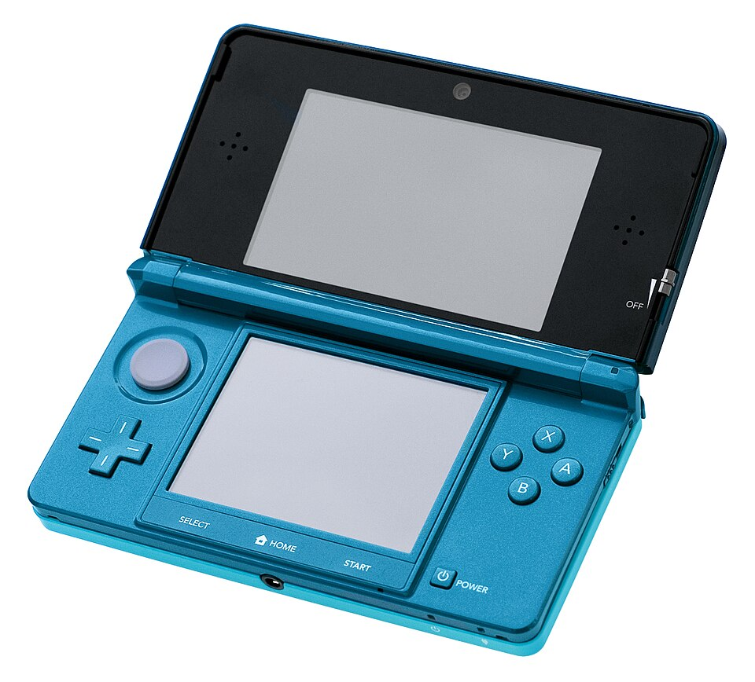 | **Nintendo 3DS** ([Q203597](https://www.wikidata.org/wiki/Q203597)) | 0.8116 |

➡️ Full write-up: [examples/game-boy/README.md](examples/game-boy/README.md)

### Nokia Manufacturer Inception Example

Determine the phone entity from a photo of a cell phone model, then follow `manufacturer (P176) → inception (P571)` in Wikidata to answer in which year the phone's manufacturer was founded.

- **Question:** In which year was this phone's manufacturer founded?
- **Gold entity:** [Q219691](https://www.wikidata.org/wiki/Q219691)

<details><summary>Gold query</summary>

```sparql
SELECT ?manufacturer ?manufacturerLabel ?inception ?inceptionYear WHERE {
  BIND(wd:Q219691 AS ?product)
  ?product wdt:P176 ?manufacturer .
  ?manufacturer wdt:P571 ?inception .
  BIND(YEAR(?inception) AS ?inceptionYear)
  SERVICE wikibase:label { bd:serviceParam wikibase:language "en". }
}
```

</details>

#### End-to-end result

**Query image** (`query/nokia_3310_blue.jpg`):


Top-5 of 26 indexed entities (embedder: `Xenova/clip-vit-base-patch32`). Expected entity **Q219691** is at rank **1**.

| # | Image | Entity | Score |
|---|---|---|---|
| 1 |  | ✅ **Nokia 3310** ([Q219691](https://www.wikidata.org/wiki/Q219691)) | 0.8596 |
| 2 |  | **Samsung SGH-X480** ([Q10366521](https://www.wikidata.org/wiki/Q10366521)) | 0.7369 |
| 3 |  | **Sony Ericsson K310i** ([Q1076838](https://www.wikidata.org/wiki/Q1076838)) | 0.7184 |
| 4 |  | **Sagem myX-6** ([Q10660048](https://www.wikidata.org/wiki/Q10660048)) | 0.7100 |
| 5 | 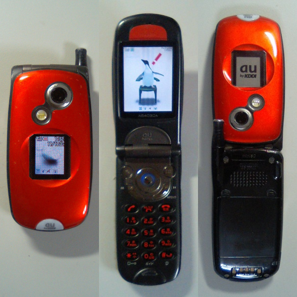 | **Casio A5403CA** ([Q11188678](https://www.wikidata.org/wiki/Q11188678)) | 0.7073 |

➡️ Full write-up: [examples/nokia/README.md](examples/nokia/README.md)

### IBM ThinkPad Manufacturer Inception Example

Determine the laptop entity from a photo of a laptop model, then follow `manufacturer (P176) → inception (P571)` in Wikidata to answer in which year the laptop's manufacturer was established.

- **Question:** In which year was the manufacturer of this laptop established?
- **Gold entity:** [Q106942963](https://www.wikidata.org/wiki/Q106942963)

<details><summary>Gold query</summary>

```sparql
SELECT ?manufacturer ?manufacturerLabel ?inception ?inceptionYear WHERE {
  BIND(wd:Q106942963 AS ?product)
  ?product wdt:P176 ?manufacturer .
  ?manufacturer wdt:P571 ?inception .
  BIND(YEAR(?inception) AS ?inceptionYear)
  SERVICE wikibase:label { bd:serviceParam wikibase:language "en". }
}
```

</details>

#### End-to-end result

**Query image** (`query/thinkpad_701_butterfly.jpg`):

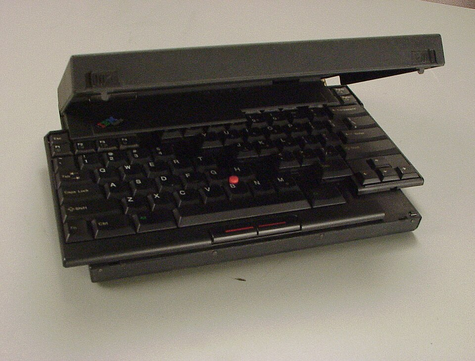

Top-5 of 26 indexed entities (embedder: `Xenova/clip-vit-base-patch32`). Expected entity **Q106942963** is at rank **1**.

| # | Image | Entity | Score |
|---|---|---|---|
| 1 | 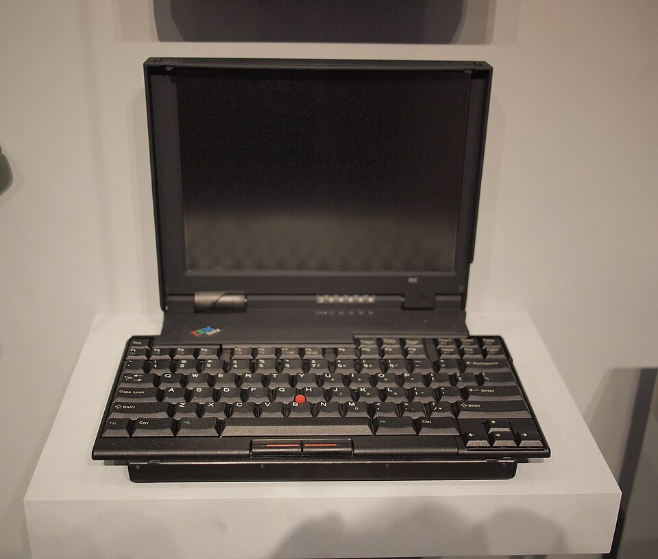 | ✅ **IBM ThinkPad 701** ([Q106942963](https://www.wikidata.org/wiki/Q106942963)) | 0.8483 |
| 2 | 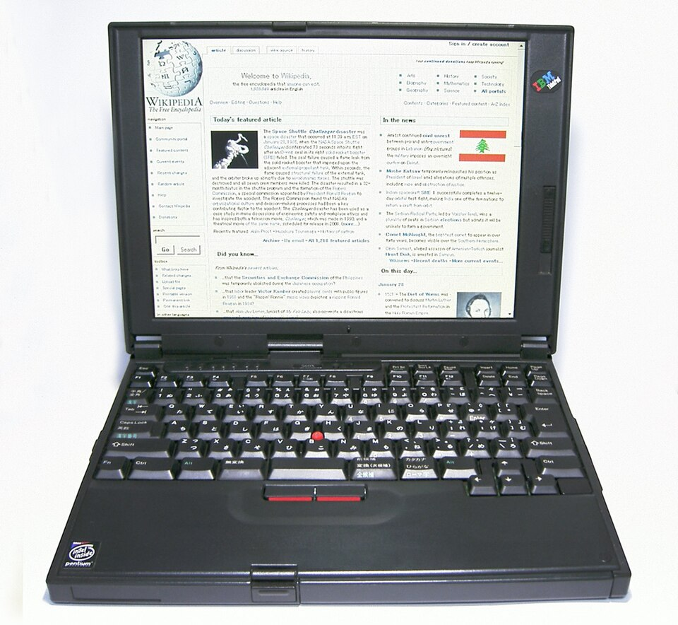 | **IBM ThinkPad 560** ([Q11251024](https://www.wikidata.org/wiki/Q11251024)) | 0.8198 |
| 3 | 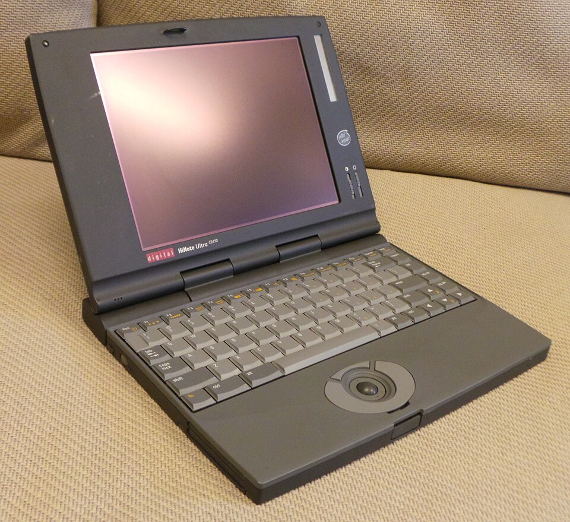 | **Digital HiNote** ([Q11195843](https://www.wikidata.org/wiki/Q11195843)) | 0.7975 |
| 4 | 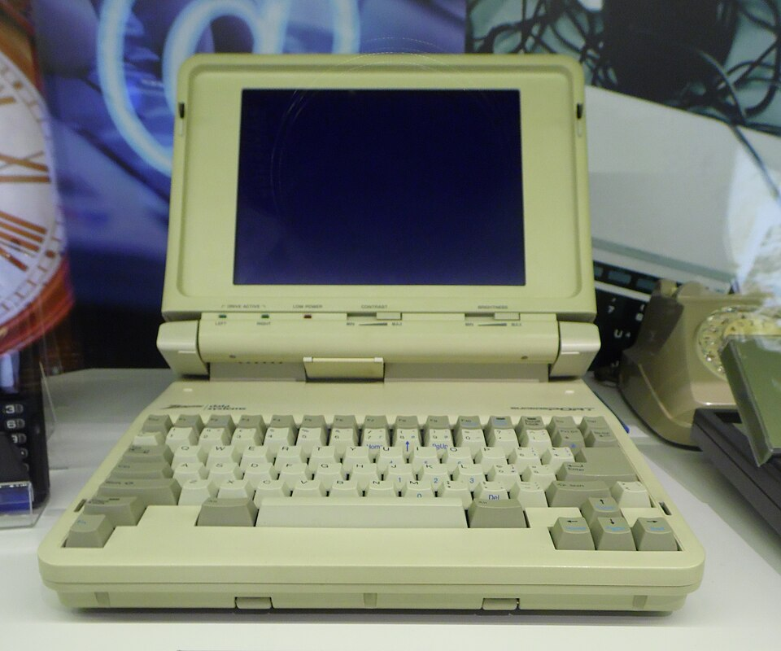 | **Zenith SupersPort** ([Q115614795](https://www.wikidata.org/wiki/Q115614795)) | 0.7953 |
| 5 | 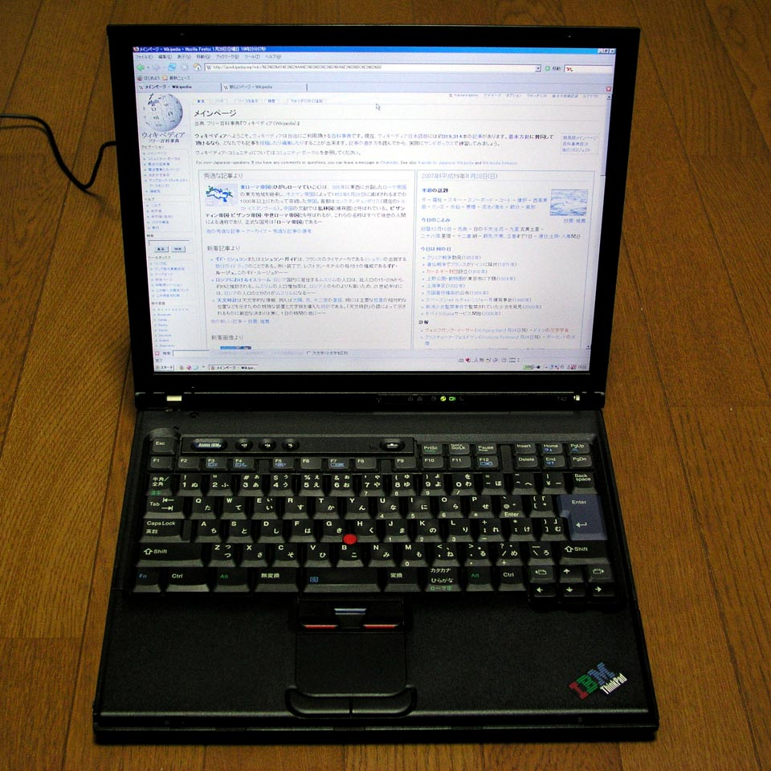 | **IBM ThinkPad T42** ([Q109967280](https://www.wikidata.org/wiki/Q109967280)) | 0.7917 |

➡️ Full write-up: [examples/thinkpad/README.md](examples/thinkpad/README.md)
