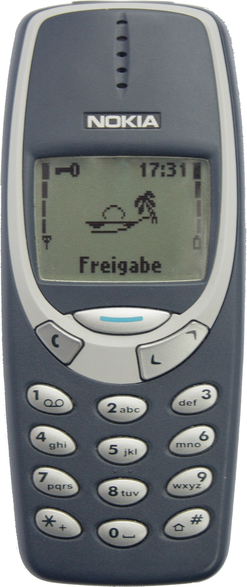
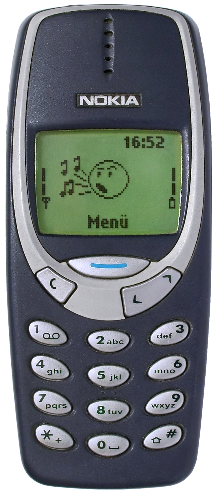
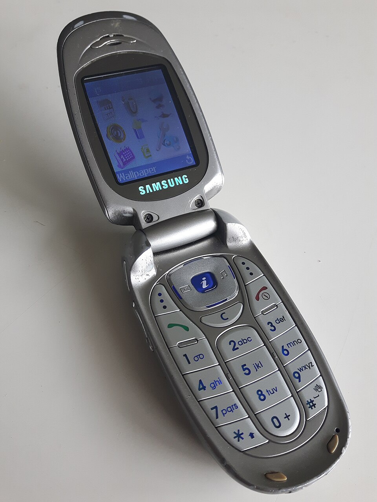
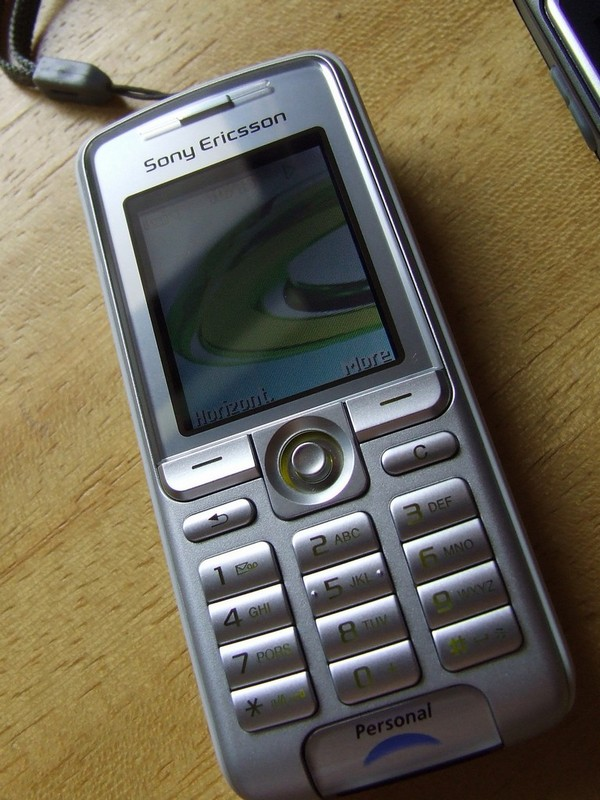
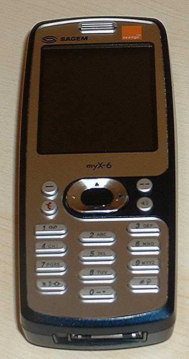

# Image QA over Wikidata – Nokia 3310 proof of concept

Each sample is an **image of an entity** plus a **question answered by walking the Wikidata graph**.

| Image | Question | Path | Answer |
|---|---|---|---|
| Nokia 3310 (Q219691) | In which year was this phone's manufacturer founded? | `manufacturer (P176) → inception (P571)` | **1865** (Nokia, Q1418) |

## Layout

```
embeddings/            reusable, swappable embedding providers (CLIP via transformers.js)
vector_index/          reusable Qdrant docker-compose + thin client wrapper
nokia_example/         this example: scripts, results, images
  01_gold_query.js     gold SPARQL for Nokia 3310
  02_download_nokia.js download the Nokia 3310 image through the SDK
  03_expand.js         SPARQL expansion -> dataset.json
  04_download_images.js resumable image download
  05_index.js          embed images + upsert entities into Qdrant
  06_query.js          image -> top-k entities
  07_attribution.js    author/licence of every image -> ATTRIBUTION.md
  query/               test query image
```

## Setup

```bash
npm install                      # wikibase-sdk, @qdrant/js-client-rest, @huggingface/transformers
mise run vector:up               # starts Qdrant on :6333 (vector:down stops it, vector:reset also wipes data)
```

## Step 1 – Gold query (`01_gold_query.js`)

`wikibase-sdk` only builds the URL (`wbk.sparqlQuery`); we `fetch` it with a `User-Agent`.
Result (`gold_query_result.json`): Nokia (Q1418), inception `1865-05-12` → **1865**. ✔ matches the expected answer.

## Step 2 – Image (`02_download_nokia.js`)

The 3310 has two P18 images; the **preferred-rank** one (`Nokia 3310 Blue R7309170 (retouch).png`) is used.
`wbk.getImageUrl(file)` yields the `Special:FilePath` URL.

## Step 3 – Expansion (`03_expand.js`)

Post-processing in JS: group by phone, drop phones with several manufacturers/inception values or several
images (ambiguous answer), drop unlabeled items, keep the first 25 by QID → `dataset.json`
(`phone, phoneLabel, image, manufacturer, manufacturerLabel, answer, question`).

## Step 4 – Images (`04_download_images.js`)

Downloads `Special:FilePath/<file>?width=512` (thumbnails, ~100–400 KB instead of multi‑MB originals),
verifies magic bytes, skips files that already exist (resumable), honours `Retry-After`.

**Caveat:** Commons rate-limits anonymous bulk downloads aggressively (HTTP 429 with `Retry-After: 600`).
Just re-run the script until all images are present. Check with `ls images | wc -l`.
The 3310 gets an additional entry in the index (it is not in the first 25 by QID), so the index holds **26** entities.

## Step 5 – Embedding + vector index

* **Vector DB: Qdrant** (docker, `vector_index/docker-compose.yml`). Small, one container, cosine HNSW index,
  stores arbitrary JSON payload next to each vector, has a dashboard at <http://localhost:6333/dashboard>.
  Point id = Wikidata numeric id, payload = `{ qid, label, image }`.
  Alternatives if you later want real graph traversal next to vectors: **Neo4j 5** (native vector index +
  Cypher) or **Weaviate**/**pgvector**; only `vector_index/qdrant.js` would need replacing.
* **Embedding model: CLIP ViT-B/32** (`Xenova/clip-vit-base-patch32`, 512-d, ~90 MB ONNX, runs on CPU in Node via
  `@huggingface/transformers`). Chosen because it embeds images *and* text into the same space (so text → entity
  search works later) and is the usual baseline. Swap by setting `EMBEDDER`:
  `EMBEDDER=clip-b16 node 05_index.js`. To add another model (SigLIP, DINOv2, …) add a provider in
  `embeddings/index.js`; it needs `name`, `dim`, `embedImages`, `embedTexts`, L2-normalised output.
  The collection name contains the model name, so different embedders never collide.

```bash
node 05_index.js
```

## Step 6 – End-to-end test

Query image: `query/nokia_3310_blue.jpg` – the **non-preferred** P18 image of the Nokia 3310 (different photo
than the indexed one), so the match is not trivial.

```bash
node 06_query.js query/nokia_3310_blue.jpg 5
```

Result (`node 06_query.js query/nokia_3310_blue.jpg 5 --md`, 26 indexed entities, CLIP B/32):

**Query image** (`query/nokia_3310_blue.jpg`):



| # | Image | Entity | Score |
|---|---|---|---|
| 1 |  | **Nokia 3310** ([Q219691](https://www.wikidata.org/wiki/Q219691)) | 0.8596 |
| 2 |  | **Samsung SGH-X480** ([Q10366521](https://www.wikidata.org/wiki/Q10366521)) | 0.7369 |
| 3 |  | **Sony Ericsson K310i** ([Q1076838](https://www.wikidata.org/wiki/Q1076838)) | 0.7184 |
| 4 |  | **Sagem myX-6** ([Q10660048](https://www.wikidata.org/wiki/Q10660048)) | 0.7100 |
| 5 |  | **Casio A5403CA** ([Q11188678](https://www.wikidata.org/wiki/Q11188678)) | 0.7073 |

Top-1 is the correct entity (a different photo of the same phone).
Plain-text output: omit `--md`.

## Images & licences

Images are Wikimedia Commons files, each under its own licence (CC BY / CC BY-SA / public domain), downscaled to 512px.
Authors and licences are listed in [ATTRIBUTION.md](ATTRIBUTION.md) (generated by `07_attribution.js`); redistributing them
requires keeping that attribution (and share-alike for the CC BY-SA ones).
